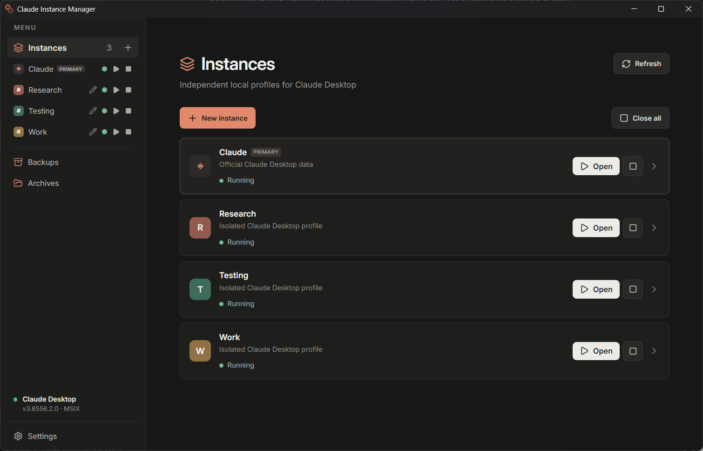
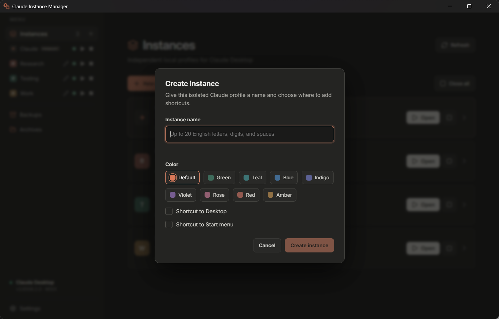

# Claude Instance Manager

<p align="center">
  
</p>

Windows desktop app for running isolated Claude Desktop profiles. The application is built with Electron, React, and TypeScript; Windows-specific operations run through a safe main-process adapter.

> This is an unofficial community tool and is not affiliated with Anthropic.

<p align="center">
  
</p>

## Support the project

If Claude Instance Manager is useful to you, you can support its development:

### Cryptocurrency

**USDT (TRC-20)**

```text
TUAyTkVoxEKnQ9qhykvUPfQN4vDswuVqhS
```

Please send USDT only through the TRC-20 network. Transfers sent over another network may be lost.

## Features

- Run isolated profiles straight from the installed Claude Desktop (MSIX, Microsoft Store or the classic installer); no copy of the app is made and no administrator prompt is needed.
- Create, launch, stop, back up, archive and pin isolated profiles; each gets its own colour-coded taskbar button.
- Sign in to a selected instance: the manager redirects the browser login callback (email, code, Google, SSO) to that instance instead of the primary profile, without moving any data.
- Two backup tiers: *session and chats* (login, chats index, Code and Cowork session lists, extensions, settings and the referenced Claude Code transcripts) or the *full profile* without caches; plus a *settings export* without secrets for another machine.
- Copy settings, or a whole session, from the primary profile or another instance, choosing which Code projects and Cowork tasks come along.
- Clean re-downloadable caches of a stopped instance with a per-folder size breakdown.
- Optional deep-link router that hands `claude://` links to the instance you used last, or asks which one.
- Manage instances from the application and system tray.

Each instance runs independently and receives a taskbar icon based on its selected colour. Pin the running window, or the Start menu shortcut, and the pinned button launches that instance.

<p align="center">
  
</p>

Create a profile with a name, colour, and optional Desktop or Start menu shortcuts.

<p align="center">
  
</p>

## Requirements

- Windows 10 or Windows 11
- Official Claude Desktop installed: the direct MSIX package, the Microsoft Store package, or the classic installer under `%LOCALAPPDATA%\AnthropicClaude`
- No administrator rights: instances start through Claude's own App Execution Alias with `--user-data-dir`.

## How Sign In works

Windows hands every `claude://` login callback to the official Claude app, which would open the primary profile. **Start Sign In** closes the primary Claude, takes over its single-instance window and forwards each callback to the selected instance. Click **Sign in** inside that instance, complete the login in the browser, then click **Finish Sign In** or simply start the primary Claude again. Other isolated instances keep running; nothing is copied or moved.

## Moving accounts out of the primary profile

If you switched between several accounts in one Claude window and want one instance per account:

1. Open the new instance, choose **Copy from…** → **Claude (Primary)** → **Settings only**. MCP servers, extensions, preferences and the Code/Cowork session lists come over; pick the Code projects you want. The login is not copied.
2. **Start Sign In** in that instance and log in to the account it is for. Chats are stored by claude.ai and appear after the login.
3. Repeat for the next instance.

**Session and login** copies are possible too, but the copy shares one token with the source: signing out there, or a token refresh, can end it.

## Upgrading from 1.0

- The portable Claude copy is no longer used. The manager rewrites old shortcuts on first start and offers to delete the `Portable` folder once.
- A Sign In started by 1.0 is finished with **Finish & Restore**, which moves the regular Claude profile back to its original location.

## Local data

- Regular Claude profile: `%APPDATA%\Claude` or `%APPDATA%\Claude Code`; MSIX installations may use `%LOCALAPPDATA%\Packages\<Claude package family>\LocalCache\Roaming\Claude`, or `%LOCALAPPDATA%\Claude-Data\<package family>` after migration. The manager detects these locations automatically.
- Isolated profiles: `%LOCALAPPDATA%\ClaudeInstanceManager\Profiles`
- Backups, settings exports and archives: `%LOCALAPPDATA%\ClaudeInstanceManager\Backups` and `Archives`
- Claude Code transcripts referenced by a profile are read from `%USERPROFILE%\.claude\projects` and included in session backups.
- The `Portable` folder of earlier versions is no longer used; the manager offers to delete it once.

## Safety

- Starting Sign In closes the primary Claude only; other isolated instances keep running. Finish the Sign In (or simply start the primary Claude again) once the login inside the instance is complete.
- Session and full backups contain an active Claude login; keep them private. Settings exports do not.
- Back up profiles before testing imports, copies or account changes.

## Development

```powershell
cd electron
npm install
npm run typecheck
npm test
npm run package:win
```

`npm test` runs the Node tests and the TaskbarHelper checks (.NET 10 SDK required). To look at the UI without Electron, run `npx vite --config vite.renderer-preview.config.mts` and open `http://localhost:5173`; the renderer then uses a development mock instead of the real manager. See `.project-guides/` for the build, storage, Sign In and taskbar details.

macOS is intentionally not implemented yet: its Claude app installation, profile paths, and SSO behaviour need a dedicated platform adapter.
